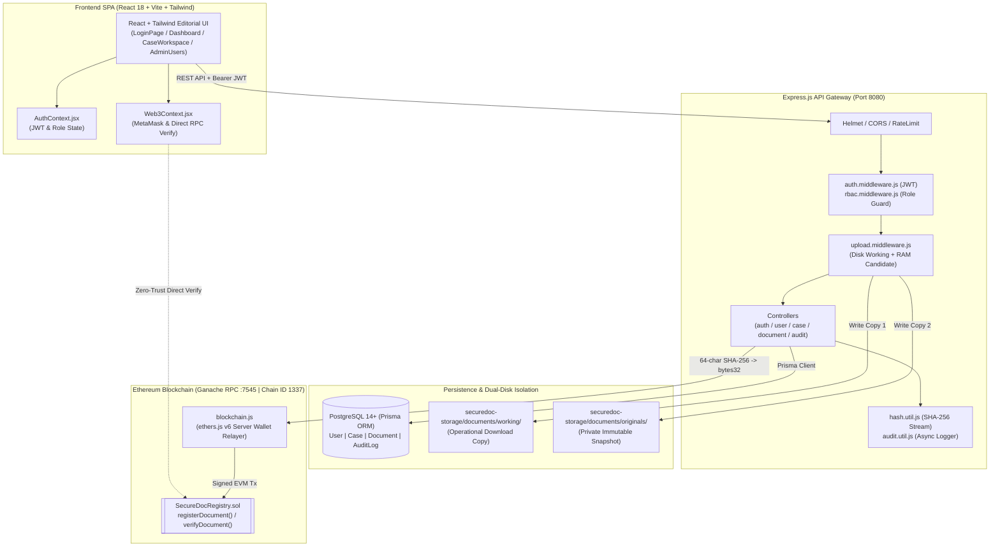
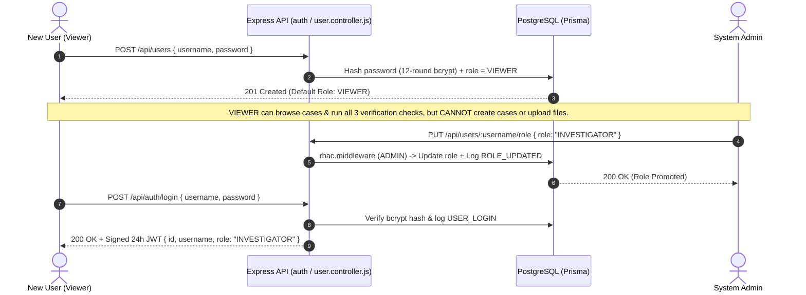
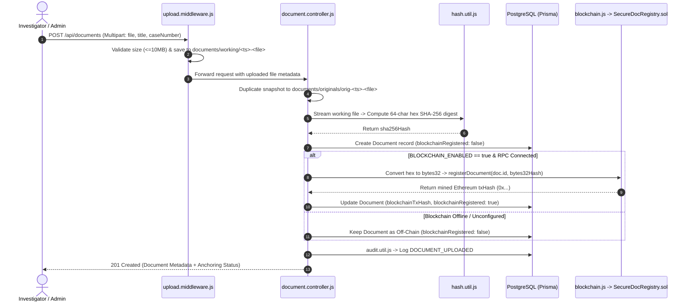

# 🛡️ SecureDoc — Cryptographic Evidence Vault & Blockchain Verification Platform


SecureDoc is a full-stack forensic document integrity, vault, and Ethereum blockchain verification platform built on the **PERN stack** (PostgreSQL, Express.js, React 18, Node.js) with local EVM smart contract anchoring.

Designed for forensic cyber-investigators, legal professionals, and digital auditing teams, SecureDoc provides **immutable dual-file storage**, **SHA-256 cryptographic sealing**, **3-tier tamper detection**, and **permanent on-chain anchoring** to guarantee strict chain of custody.

---

## 🎯 Why SecureDoc? (Problem vs. Solution)

| Vulnerability in Traditional Systems | How SecureDoc Solves It |
| :--- | :--- |
| **Silent Database Manipulation:** A compromised DBA or attacker can modify a stored file and overwrite its database checksum to hide tampering. | **On-Chain EVM Anchoring:** Document SHA-256 digests (`bytes32`) are anchored onto `SecureDocRegistry.sol`. Even if PostgreSQL is compromised, the smart contract record cannot be altered. |
| **Storage-Level File Corruption:** Operational files served to users might be accidentally modified or replaced on disk. | **Dual-Disk Isolation:** Every upload is split into a mutable operational copy (`working/`) and a private, unexposed snapshot (`originals/`). |
| **Unverified External Copies:** Courts or auditors receiving an exported file cannot easily tell if 1 byte was altered in transit. | **Zero-Disk-Write RAM Tamper Check:** Auditors upload suspect files into RAM (`multer.memoryStorage()`) to compute live SHA-256 hashes against the Ethereum blockchain without writing untrusted files to disk. |
| **Privilege Escalation:** Open sign-up portals risk giving unauthorized users upload or deletion rights. | **Strict Least-Privilege RBAC:** Self-registration defaults strictly to `VIEWER` (read/verify only). Only an `ADMIN` can promote a user to `INVESTIGATOR`. |

---

## 🏛️ System Architecture

### 1. High-Level Interactive Architecture (Mermaid)



### 2. ASCII System Topology

```text
+---------------------------------------------------------------------------------------------------------+
|                                        SECUREDOC ARCHITECTURE                                           |
+---------------------------------------------------------------------------------------------------------+
                                                     |
                     +-------------------------------+-------------------------------+
                     |                                                               |
                     v                                                               v
      +-----------------------------+                                 +-----------------------------+
      |      Web3 / MetaMask        |                                 |    React 18 + Vite (SPA)    |
      |   window.ethereum / ethers  | <=============================> |    Tailwind Editorial UI    |
      +-----------------------------+     Direct RPC Verification     +-----------------------------+
                     |                                                               |
                     |                                                               | HTTP / JSON REST
                     |                                                               v
                     |                                                +-----------------------------+
                     |                                                |   Express.js API Gateway    |
                     |                                                |   Helmet / CORS / RateLimit |
                     |                                                +-----------------------------+
                     |                                                               |
                     |                                        +----------------------+----------------------+
                     |                                        |                      |                      |
                     |                                        v                      v                      v
                     |                               +------------------+   +------------------+   +------------------+
                     |                               |  JWT & RBAC Auth |   | Multer Dual-Disk |   |   Audit Logger   |
                     |                               |  Admin/Invest/   |   | Storage Pipeline |   |  ipAddress/User  |
                     |                               |      Viewer      |   | working/original |   |    Chronology    |
                     |                               +------------------+   +------------------+   +------------------+
                     |                                        |                      |                      |
                     v                                        v                      v                      v
      +-----------------------------+                +------------------+   +------------------+   +------------------+
      |  EVM Blockchain (Ganache)   | <============> | Blockchain Relayer|  |  Prisma Client   |   | Local Disk Store |
      |     Chain ID 1337 / RPC     |  ethers.js v6  |  (ethers Wallet) |  |   (PostgreSQL)   |   | working/original |
      |    SecureDocRegistry.sol    |                +------------------+   +------------------+   +------------------+
      +-----------------------------+                                                |
                                                                                     v
                                                                            +------------------+
                                                                            | PostgreSQL 14+   |
                                                                            | User, Case, Doc, |
                                                                            | AuditLog Models  |
                                                                            +------------------+
```

---

## 🔄 Visual Workflow Pipelines (End-to-End Request Flows)

### Flow 1: Authentication & Least-Privilege RBAC Promotion
Every self-registered user starts as a `VIEWER`. Only an `ADMIN` can promote an account to `INVESTIGATOR` or `ADMIN`.



---

### Flow 2: Forensic Evidence Ingestion, Dual-Disk Isolation & Smart Contract Sealing



---

### Flow 3: Three-Way Cryptographic Verification Engine

```mermaid
flowchart TB
    subgraph Tier1 ["1. Local Integrity Check (GET /api/documents/:id/verify)"]
        A1["Read File from\ndocuments/working/"] --> A2["Compute Live SHA-256\n(hash.util.js)"]
        A2 --> A3{"Matches PostgreSQL\nsha256Hash?"}
        A3 -->|Yes| A4["Status: VERIFIED\n(Disk File Intact)"]
        A3 -->|No| A5["Status: TAMPERED\n(Local Disk Altered)"]
    end

    subgraph Tier2 ["2. Blockchain Anchor Check (GET /api/documents/:id/blockchain-verify)"]
        B1["Re-compute Live SHA-256\nfrom Disk (localHash)"] --> B2["Query Smart Contract\ngetDocument(docId)"]
        B2 --> B3{"localHash ===\nonChainHash (bytes32)?"}
        B3 -->|Yes| B4["Status: VERIFIED\n(Matches Immutable EVM Ledger)"]
        B3 -->|No| B5["Status: TAMPERED\n(DB/Disk Diverged from Chain)"]
    end

    subgraph Tier3 ["3. Suspect Candidate Upload (POST /api/documents/:id/blockchain-verify-upload)"]
        C1["Upload Suspect File into RAM\n(multer.memoryStorage - 0 Disk Write)"] --> C2["Compute Candidate SHA-256\nfrom Memory Buffer"]
        C2 --> C3{"Matches On-Chain\nRegistered Hash?"}
        C3 -->|100% Match| C4["verificationStatus: VERIFIED\n(Authentic Copy)"]
        C3 -->|Even 1-Byte Diff| C5["verificationStatus: TAMPERED\n(Alert Logged in Audit Trail)"]
    end
```



---

## 📁 Repository Directory Structure

```text
SecureDoc-PERN/
├── README.md                               # Root production documentation
├── .gitignore                              # Git ignore rules (node_modules, .env, dist, storage)
│
├── blockchain/                             # Ethereum Smart Contract & Local EVM Scripts
│   ├── contracts/
│   │   └── SecureDocRegistry.sol           # Solidity ^0.8.24 registry smart contract
│   ├── scripts/
│   │   └── compileAndDeploy.js             # Automated solc compilation & Ganache deployment
│   ├── abi/
│   │   └── SecureDocRegistry.json          # Compiled ABI and EVM Bytecode
│   └── package.json                        # solc, ethers v6, dotenv
│
├── securedoc-backend/                      # Node.js + Express + Prisma REST API
│   ├── prisma/
│   │   └── schema.prisma                   # PostgreSQL database schema & models
│   ├── securedoc-storage/                  # Forensic file storage
│   │   └── documents/
│   │       ├── working/                    # Mutable operational copies served for download
│   │       └── originals/                  # Immutable original snapshots sealed upon upload
│   ├── src/
│   │   ├── config/
│   │   │   ├── db.js                       # Prisma client connection & admin bootstrap
│   │   │   └── blockchain.js               # ethers.js contract wrapper, relayer & fallback
│   │   ├── controllers/
│   │   │   ├── auth.controller.js          # User login & JWT issuance
│   │   │   ├── user.controller.js          # User registration, lookup & RBAC updates
│   │   │   ├── case.controller.js          # Investigation cases CRUD
│   │   │   ├── document.controller.js      # Upload, verify, tamper check, download, search
│   │   │   └── audit.controller.js         # Forensic timeline & system audit logs
│   │   ├── middlewares/
│   │   │   ├── auth.middleware.js          # Bearer JWT extraction & token validation
│   │   │   ├── rbac.middleware.js          # Role-based access control enforcement
│   │   │   ├── upload.middleware.js        # Multer disk (working) & memory (candidate)
│   │   │   └── error.middleware.js         # Centralized error & Prisma exception handler
│   │   ├── routes/
│   │   │   ├── auth.routes.js              # /api/auth routes
│   │   │   ├── user.routes.js              # /api/users routes
│   │   │   ├── case.routes.js              # /api/cases routes
│   │   │   ├── document.routes.js          # /api/documents routes
│   │   │   └── audit.routes.js             # /api/audit routes
│   │   ├── utils/
│   │   │   ├── hash.util.js                # Stream/buffer SHA-256 digest computation
│   │   │   └── audit.util.js               # Safe asynchronous audit log writer
│   │   └── server.js                       # Express app bootstrap, helmet, CORS, rate-limit
│   ├── scripts/
│   │   └── test-e2e.js                     # Automated 13-stage end-to-end integration test
│   ├── .env.example                        # Backend environment variable template
│   ├── .env                                # Local backend environment settings
│   └── package.json                        # Backend dependencies & npm run scripts
│
└── securedoc-frontend/                     # React 18 + Vite + Tailwind CSS Single Page App
    ├── public/
    │   ├── favicon.svg                     # Custom SVG badge icon
    │   └── SecureDocRegistry.json          # Copied ABI for in-browser Web3 verification
    ├── src/
    │   ├── api/
    │   │   └── client.js                   # Axios client with JWT interceptor & 401 handling
    │   ├── context/
    │   │   ├── AuthContext.jsx             # User state, JWT storage, role helpers
    │   │   └── Web3Context.jsx             # MetaMask connect, Ganache RPC check, on-chain verify
    │   ├── components/
    │   │   ├── layout/
    │   │   │   └── AppLayout.jsx           # App shell, sticky nav, blockchain status widget
    │   │   └── ui/                         # Reusable UI primitives
    │   ├── pages/
    │   │   ├── auth/
    │   │   │   └── LoginPage.jsx           # Sign in/register portal with 1-click admin demo
    │   │   ├── cases/
    │   │   │   └── CaseWorkspacePage.jsx   # Case vault, document cards & 4 forensic actions
    │   │   ├── admin/
    │   │   │   └── AdminUsersPage.jsx      # User lookup & RBAC role switcher
    │   │   └── DashboardPage.jsx           # Metric cards, global evidence search & cases table
    │   ├── App.jsx                         # React Router route hierarchy & ProtectedRoute
    │   ├── main.jsx                        # React root bootstrap & toast notification provider
    │   └── index.css                       # Tailwind directives & custom CSS design tokens
    ├── index.html                          # HTML5 shell loading Inter & IBM Plex Mono fonts
    ├── vite.config.js                      # Vite config with API proxy to port 8080
    ├── tailwind.config.js                  # Tailwind v3 config extending custom color palette
    ├── postcss.config.js                   # PostCSS plugin pipeline (tailwindcss + autoprefixer)
    ├── .env.example                        # Frontend environment variable template
    ├── .env                                # Frontend local environment settings
    └── package.json                        # Frontend dependencies & npm overrides (Rollup WASM)
```

---

## 🔄 Complete A-to-Z Architectural Breakdown

### 1. Identity & Role-Based Access Control (RBAC)
- Public user registration (`POST /api/users` or `/api/auth/register`) automatically assigns the `VIEWER` role by default.
- Users authenticate via `POST /api/auth/login`. Passwords are verified against 12-round `bcrypt` hashes.
- A signed JSON Web Token (JWT) is issued containing `{ id, username, role }` with a 24-hour expiration (`JWT_EXPIRES_IN`).
- All protected API routes enforce JWT verification through `auth.middleware.js` and role constraints through `rbac.middleware.js` (`requireRole('ADMIN', 'INVESTIGATOR')`).
- Admins can promote/demote user roles at `PUT /api/users/:username/role`.

### 2. Investigation Case Management
- Investigators and Admins create a case record via `POST /api/cases` specifying a unique `caseNumber` (e.g., `CASE-2026-001`), `title`, and optional `description`.
- Each case tracks ownership (`createdById`) and groups forensic evidence documents.

### 3. Forensic Document Ingestion & Dual Storage
When an investigator uploads a file via `POST /api/documents`:
1. **Multipart Validation:** Multer enforces size restrictions (`MAX_FILE_SIZE_MB`, default 10MB) and checks required fields.
2. **Dual-Disk Isolation:**
   - **Working Copy:** Saved to `./securedoc-storage/documents/working/<timestamp>-<filename>`.
   - **Immutable Snapshot:** Instantly duplicated to `./securedoc-storage/documents/originals/orig-<timestamp>-<filename>`.
3. **Cryptographic Sealing:** A Node.js read stream calculates the 64-character lowercase hexadecimal **SHA-256** checksum.
4. **PostgreSQL Persistence:** Metadata is stored in PostgreSQL via Prisma. The `originalFilePath` is kept internal and **never exposed** through public API responses or download endpoints.
5. **Ethereum Blockchain Anchoring:**
   - If `BLOCKCHAIN_ENABLED=true` and an RPC connection exists, the 64-character hex hash is converted to an EVM-compatible `bytes32` value (`0x...`).
   - The backend wallet relayer signs and broadcasts `registerDocument(documentId, bytes32Hash)` to the deployed `SecureDocRegistry` smart contract on Ganache.
   - The mined transaction hash is recorded in PostgreSQL (`blockchainTxHash`), setting `blockchainRegistered = true`.
6. **Audit Trail Logging:** A `DOCUMENT_UPLOADED` event is appended to the audit ledger.

### 4. Three-Way Cryptographic Verification
1. **Local Integrity Verification (`GET /api/documents/:id/verify`):**
   Re-reads the working file from disk, re-computes its live SHA-256 hash, and compares it against `sha256Hash` stored in PostgreSQL. Confirms whether local files have been modified or corrupted on server storage.
2. **Blockchain Anchoring Verification (`GET /api/documents/:id/blockchain-verify`):**
   Re-computes the live file hash on disk (`localHash`), queries the Ethereum smart contract via `SecureDocRegistry.sol::getDocument(id)`, unpacks the on-chain `bytes32` hash (`onChainHash`), and asserts `localHash === onChainHash`. Confirms absolute immutability against third-party ledger proofs.
3. **Suspect Candidate File Tamper Check (`POST /api/documents/:id/blockchain-verify-upload`):**
   Accepts an external suspect file via multipart upload. The file is held strictly in a RAM buffer (`multer.memoryStorage()`) with **zero writes to server disk**. Computes the candidate's SHA-256 checksum and compares it against the on-chain registered hash:
   - Returns `"verificationStatus": "VERIFIED"` if hashes match 100%.
   - Returns `"verificationStatus": "TAMPERED"` if even a single byte differs.

### 5. Immutable Audit Trail
Every security-relevant operation logs an entry in the `AuditLog` table containing:
- `action` (`USER_LOGIN`, `ROLE_UPDATED`, `CASE_CREATED`, `DOCUMENT_UPLOADED`, `DOCUMENT_DOWNLOADED`, `HASH_VERIFIED`, `BLOCKCHAIN_VERIFIED`, `CANDIDATE_VERIFIED`)
- `details` (human-readable context, e.g. status outcome or mismatch alerts)
- `ipAddress` (client IP)
- `userId` (acting user)
- `documentId` (associated evidence file, when applicable)
- `timestamp` (UTC ISO timestamp)

---

## 📊 Database Schema (PostgreSQL / Prisma)

### Enums
- **`Role`**: `ADMIN` | `INVESTIGATOR` | `VIEWER`

### Tables & Fields

| Model | Field | Type | Attributes / Constraints | Description |
|---|---|---|---|---|
| **`User`** | `id` | `Int` | `@id @default(autoincrement())` | Primary key |
| | `username` | `String` | `@unique` | Login username |
| | `password` | `String` | | 12-round bcrypt hash |
| | `fullName` | `String?` | Optional | User's full name |
| | `email` | `String?` | `@unique` Optional | User's email |
| | `role` | `Role` | `@default(VIEWER)` | RBAC role |
| | `createdAt` | `DateTime` | `@default(now())` | Creation timestamp |
| | `updatedAt` | `DateTime` | `@updatedAt` | Update timestamp |
| **`Case`** | `id` | `Int` | `@id @default(autoincrement())` | Primary key |
| | `caseNumber` | `String` | `@unique` | Case identifier (e.g. `CASE-2026-001`) |
| | `title` | `String` | | Case title |
| | `description` | `String?` | Optional | Detailed case briefing |
| | `status` | `String` | `@default("OPEN")` | Case status (`OPEN`, `CLOSED`, etc.) |
| | `createdById` | `Int` | FK -> `User.id` | Investigator who created the case |
| | `createdAt` | `DateTime` | `@default(now())` | Creation timestamp |
| | `updatedAt` | `DateTime` | `@updatedAt` | Update timestamp |
| **`Document`** | `id` | `Int` | `@id @default(autoincrement())` | Primary key |
| | `title` | `String` | | Evidence document title |
| | `fileName` | `String` | | Original uploaded filename |
| | `mimeType` | `String` | | MIME content-type |
| | `fileSize` | `Int` | | File size in bytes |
| | `filePath` | `String` | | Working file path on disk |
| | `originalFilePath` | `String` | | Immutable original snapshot path (private) |
| | `sha256Hash` | `String` | | 64-char lowercase hex checksum |
| | `blockchainTxHash`| `String?` | Optional | Ethereum transaction hash (0x...) |
| | `blockchainRegistered`| `Boolean` | `@default(false)` | Anchoring status on smart contract |
| | `caseId` | `Int` | FK -> `Case.id` | Associated case |
| | `uploadedById` | `Int` | FK -> `User.id` | Uploader user ID |
| | `createdAt` | `DateTime` | `@default(now())` | Upload timestamp |
| | `updatedAt` | `DateTime` | `@updatedAt` | Update timestamp |
| **`AuditLog`** | `id` | `Int` | `@id @default(autoincrement())` | Primary key |
| | `action` | `String` | | Action identifier tag |
| | `details` | `String?` | Optional | Event details |
| | `ipAddress` | `String?` | Optional | Client IP address |
| | `documentId` | `Int?` | FK -> `Document.id` Optional | Related document ID |
| | `userId` | `Int?` | FK -> `User.id` Optional | Actor user ID |
| | `timestamp` | `DateTime` | `@default(now())` | Event timestamp |

---

## 🌐 REST API Endpoints

All protected endpoints require an `Authorization: Bearer <jwt_token>` header.

| Method | Endpoint | Allowed Roles | Request Body / Params | Description |
|---|---|---|---|---|
| `GET` | `/health` | Public | None | Server health, status, and blockchain integration flag |
| `POST` | `/api/auth/login` | Public | `{ username, password }` | Authenticates user, logs `USER_LOGIN`, returns JWT & user profile |
| `POST` | `/api/auth/register` | Public | `{ username, password, email?, fullName? }` | Alias for user registration (assigns `VIEWER` role) |
| `POST` | `/api/users` | Public | `{ username, password, email?, fullName? }` | Registers a new user account with default `VIEWER` role |
| `GET` | `/api/users/username/:username` | `ADMIN` | Route param `:username` | Retrieves detailed user profile |
| `PUT` | `/api/users/:username/role` | `ADMIN` | `{ role: "ADMIN" \| "INVESTIGATOR" \| "VIEWER" }` | Updates user's RBAC role; logs `ROLE_UPDATED` |
| `GET` | `/api/cases` | All Authenticated | None | Retrieves all cases with document counts and creator details |
| `GET` | `/api/cases/:caseNumber` | All Authenticated | Route param `:caseNumber` | Retrieves case details with associated documents |
| `POST` | `/api/cases` | `ADMIN`, `INVESTIGATOR` | `{ caseNumber, title, description? }` | Creates a new case; logs `CASE_CREATED` |
| `POST` | `/api/documents` | `ADMIN`, `INVESTIGATOR` | Multipart: `file`, `title`, `caseNumber` or `caseId` | Ingests file, dual-stores, computes SHA-256, anchors on EVM |
| `GET` | `/api/documents/search` | All Authenticated | Query param `?query=<term>` | Searches documents by title, fileName, or caseNumber |
| `GET` | `/api/documents/case/:caseNumber` | All Authenticated | Route param `:caseNumber` | Retrieves all documents belonging to a case |
| `GET` | `/api/documents/:id` | All Authenticated | Route param `:id` | Retrieves document metadata (hides internal `originalFilePath`) |
| `GET` | `/api/documents/:id/verify` | All Authenticated | Route param `:id` | Re-hashes working file on disk, verifies vs DB; logs `HASH_VERIFIED` |
| `GET` | `/api/documents/:id/download` | All Authenticated | Route param `:id` | Streams working file as attachment; logs `DOCUMENT_DOWNLOADED` |
| `GET` | `/api/documents/:id/blockchain-verify` | All Authenticated | Route param `:id` | Compares disk SHA-256 against on-chain smart contract hash |
| `POST` | `/api/documents/:id/blockchain-verify-upload` | All Authenticated | Multipart: `file` (candidate file) | Hashes uploaded candidate in-memory, checks vs chain for tampering |
| `GET` | `/api/audit/document/:documentId` | All Authenticated | Route param `:documentId` | Chronological audit trail for an evidence document |
| `GET` | `/api/audit` | `ADMIN` | Query param `?limit=100` | System-wide recent audit logs |

---

## ⛓️ Smart Contract Details (`SecureDocRegistry.sol`)

- **Contract Name:** `SecureDocRegistry`
- **Compiler Version:** Solidity `^0.8.24` (SPDX: MIT)
- **Target Network:** Local EVM Blockchain (Ganache at `http://127.0.0.1:7545`, Chain ID `1337`)

### Data Structure & State
```solidity
struct DocumentRecord {
    bytes32 fileHash;      // 32-byte cryptographic SHA-256 digest
    address registeredBy;  // Wallet address of relayer / investigator
    uint256 registeredAt;  // Block timestamp of registration
    bool exists;           // Registration existence guard
}

mapping(uint256 => DocumentRecord) private documents;
```

### Methods
1. **`registerDocument(uint256 documentId, bytes32 fileHash) external`**
   - Reverts if `documents[documentId].exists` is true (`"Document already registered"`).
   - Reverts if `fileHash == bytes32(0)` (`"File hash cannot be zero"`).
   - Stores the document record with `msg.sender` and `block.timestamp`.
   - Emits event: `DocumentRegistered(documentId, fileHash, msg.sender, block.timestamp)`.
2. **`verifyDocument(uint256 documentId, bytes32 fileHash) external view returns (bool)`**
   - Returns `true` if the document exists and the stored `fileHash` matches the provided hash.
3. **`getDocumentHash(uint256 documentId) external view returns (bytes32)`**
   - Reverts if the document is not registered; returns the stored `bytes32 fileHash`.
4. **`getDocument(uint256 documentId) external view returns (bytes32 fileHash, address registeredBy, uint256 registeredAt, bool exists)`**
   - Returns the full immutable record for verification and audit inspection.

---

## 🛡️ Role Permissions Matrix

| Capability / Action | `VIEWER` | `INVESTIGATOR` | `ADMIN` |
|---|:---:|:---:|:---:|
| User Registration & Login | ✅ | ✅ | ✅ |
| View Cases Directory (`GET /api/cases`) | ✅ | ✅ | ✅ |
| View Case Evidence Vault (`GET /api/cases/:caseNumber`) | ✅ | ✅ | ✅ |
| Global Evidence Search (`GET /api/documents/search`) | ✅ | ✅ | ✅ |
| Download Evidence Files (`GET /api/documents/:id/download`) | ✅ | ✅ | ✅ |
| Run Local Hash Verification (`GET /api/documents/:id/verify`) | ✅ | ✅ | ✅ |
| Run Blockchain Verification (`GET /api/documents/:id/blockchain-verify`) | ✅ | ✅ | ✅ |
| Run Candidate Tamper Check (`POST /api/documents/:id/blockchain-verify-upload`) | ✅ | ✅ | ✅ |
| View Document Audit Trail (`GET /api/audit/document/:id`) | ✅ | ✅ | ✅ |
| Create New Case (`POST /api/cases`) | ❌ | ✅ | ✅ |
| Upload Evidence & Anchor to Blockchain (`POST /api/documents`) | ❌ | ✅ | ✅ |
| View System-Wide Audit Log (`GET /api/audit`) | ❌ | ❌ | ✅ |
| Lookup Any User Account (`GET /api/users/username/:username`) | ❌ | ❌ | ✅ |
| Modify User Roles (`PUT /api/users/:username/role`) | ❌ | ❌ | ✅ |

---

## 🎨 UI Design System: Custom Technical Editorial

The frontend interface (`securedoc-frontend`) is engineered with a custom token-driven **Tailwind CSS** architecture focused on clean, distraction-free forensic inspection:
- **Palette:** High-contrast neutral surfaces with an amber signal accent (`#c17d2a`) and semantic status indicators for verified, off-chain, and tampered states.
- **Typography:** Google Fonts pairing of **Inter** for clean UI hierarchy and **IBM Plex Mono** for cryptographic proofs, wallet addresses, and SHA-256 hashes.
- **Craft Details:** Crisp hairline borders, instant `:focus-visible` rings on all interactive elements, and `prefers-reduced-motion` support.
- **Accessibility & Contrast:** Verified keyboard navigation, high-contrast legibility, and responsive layouts across all views.

---

## 🚀 Step-by-Step Local Setup & Run Guide

### Prerequisites
- **Node.js** v18.x or v20.x
- **npm** v9.x or v10.x
- **PostgreSQL** v14+ running on port `5432`
- **Ganache** (GUI or CLI) running on port `7545` with Chain ID `1337`

> [!NOTE]
> **Windows Rollup Override Note:**
> In `securedoc-frontend/package.json`, an npm override (`"overrides": { "rollup": "npm:@rollup/wasm-node" }`) is included. This ensures Vite builds smoothly on Windows environments without triggering native C++ compilation or optional dependency failures with `@rollup/rollup-win32-x64-msvc`.

---

### Step 1: Clone Repository & Create Database
```bash
git clone <repository_url>
cd SecureDoc-PERN

# Open PostgreSQL (psql) and create the database:
psql -U postgres -c "CREATE DATABASE securedoc;"
```

---

### Step 2: Start Local EVM Blockchain (Ganache)
Launch **Ganache UI** or run the CLI:
```bash
npx ganache --port 7545 --chain.chainId 1337 --chain.networkId 1337 --deterministic
```
Make sure:
- RPC Server: `http://127.0.0.1:7545`
- Network / Chain ID: `1337`

---

### Step 3: Compile & Deploy Smart Contract
```bash
cd blockchain
npm install

# Compile Solidity contract and deploy to Ganache:
node scripts/compileAndDeploy.js
```
*Output will display:*
```text
📦 Compiling SecureDocRegistry.sol...
✅ ABI and bytecode saved to blockchain/abi/SecureDocRegistry.json
🔗 Connecting to Ganache at [http://127.0.0.1:7545](http://127.0.0.1:7545)...
🚀 Deploying SecureDocRegistry...
✅ Contract deployed at: 0x...
✅ Updated securedoc-backend/.env with contract address
```

> [!TIP]
> Copy the deployed contract address and set `VITE_CONTRACT_ADDRESS="0x..."` in `securedoc-frontend/.env` and `BLOCKCHAIN_PRIVATE_KEY="0x..."` (Account 0 key from Ganache) in `securedoc-backend/.env`.

---

### Step 4: Configure & Launch Backend
```bash
cd ../securedoc-backend
npm install

# Copy environment template if .env does not exist:
cp .env.example .env

# Synchronize PostgreSQL schema via Prisma:
npx prisma generate
npx prisma db push

# Start the Express server:
npm run dev
```
*The server starts on port `8080` (matching `http://localhost:8080`).*
*On first startup, the database automatically bootstraps the default administrator account.*

---

### Step 5: Configure & Launch Frontend
```bash
cd ../securedoc-frontend
npm install

# Copy environment template if .env does not exist:
cp .env.example .env

# Start the Vite development server:
npm run dev
```
*Open your browser at `http://localhost:5173`.*

---

### Step 6: Run Automated End-to-End Test Suite
With the backend running on port `8080`, execute the automated integration test:
```bash
cd ../securedoc-backend
npm run test:e2e
# (or: node scripts/test-e2e.js)
```
The script validates all 13 stages:
1. Admin login (`POST /api/auth/login`)
2. User registration (`POST /api/users`)
3. Role promotion to `INVESTIGATOR` (`PUT /api/users/:username/role`)
4. Upgraded user authentication
5. Case creation (`POST /api/cases`)
6. Multipart file upload & blockchain anchoring (`POST /api/documents`)
7. Local SHA-256 integrity check (`GET /api/documents/:id/verify`)
8. On-chain smart contract verification (`GET /api/documents/:id/blockchain-verify`)
9. Suspect candidate tamper detection (`POST /api/documents/:id/blockchain-verify-upload`) asserting `TAMPERED` status
10. Authentic candidate verification asserting `VERIFIED` status
11. Document audit trail retrieval (`GET /api/audit/document/:id`)
12. Evidence document search (`GET /api/documents/search`)
13. Case directory listing (`GET /api/cases`)

---

## 🔑 Demo Credentials

| Role | Username | Password | Auto-Fill Shortcut |
|---|---|---|---|
| **System Administrator** | `admin` | `admin123` | Click **"Auto-fill admin demo"** on `/login` |
| **New Registrations** | Custom | Custom | Self-service on `/login` (default `VIEWER` role) |